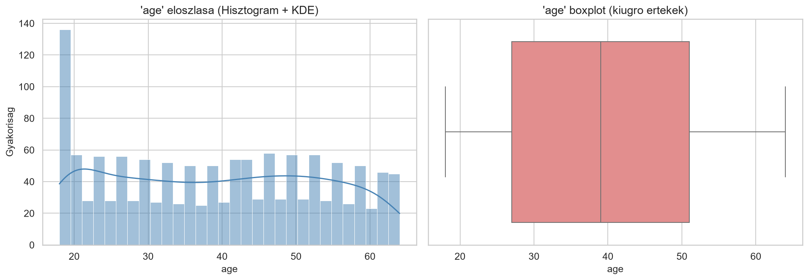
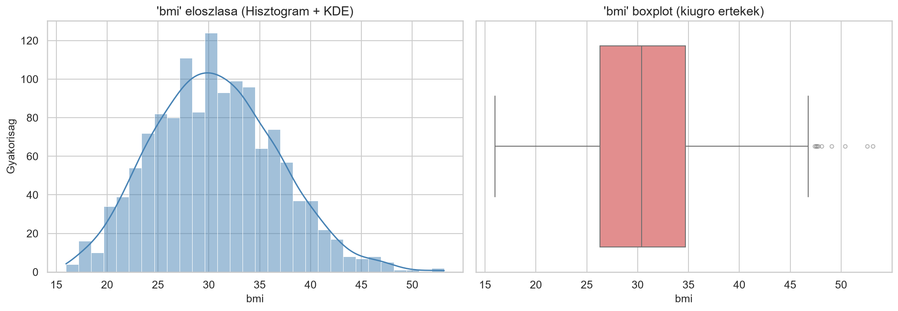
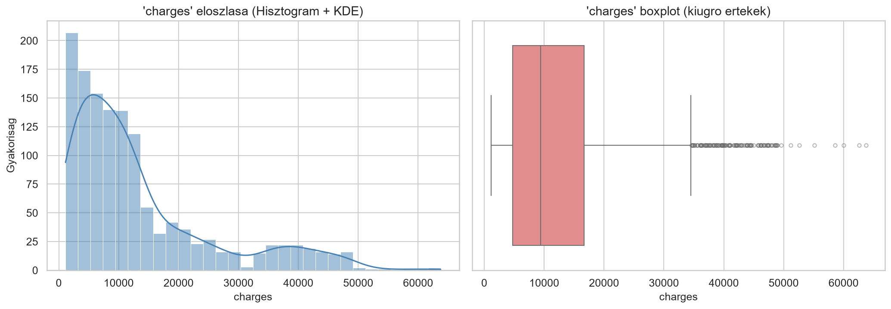
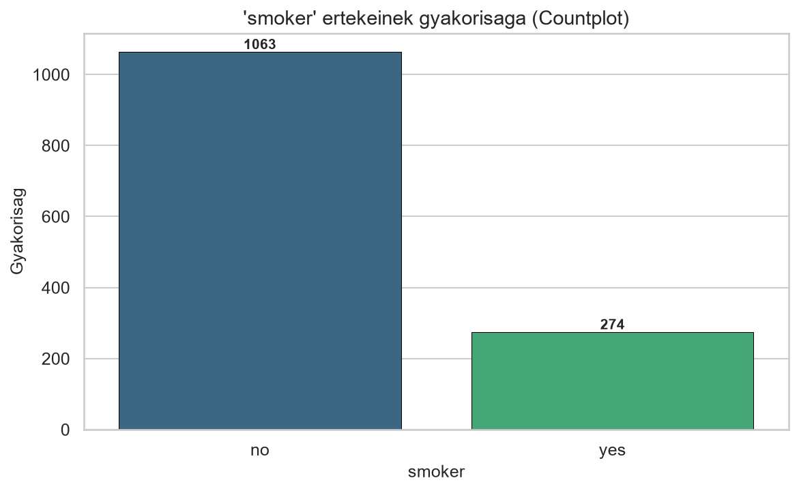
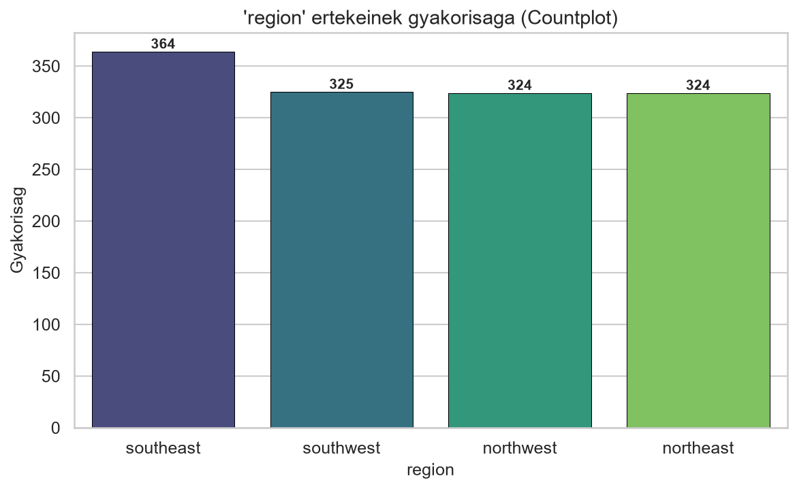
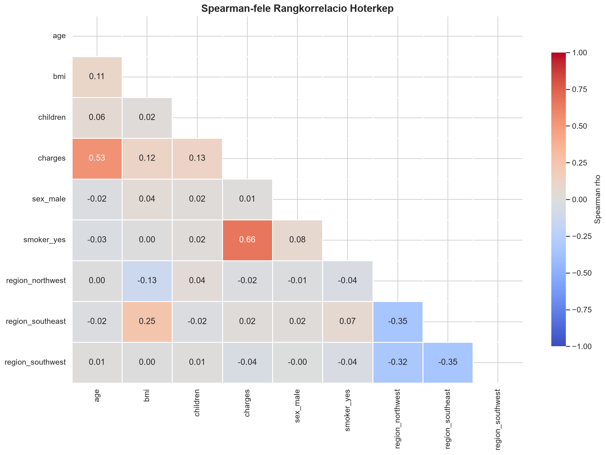
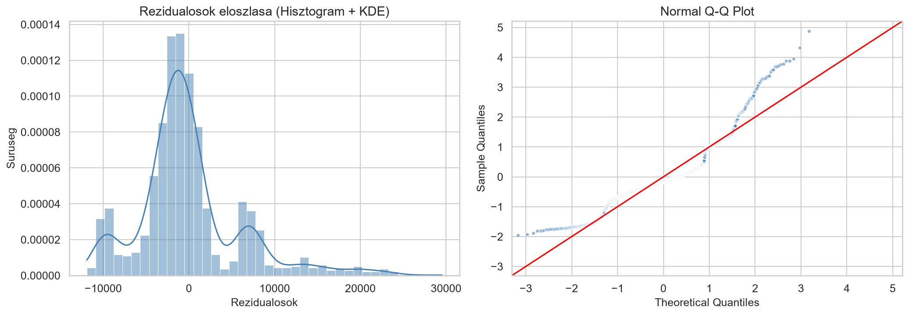
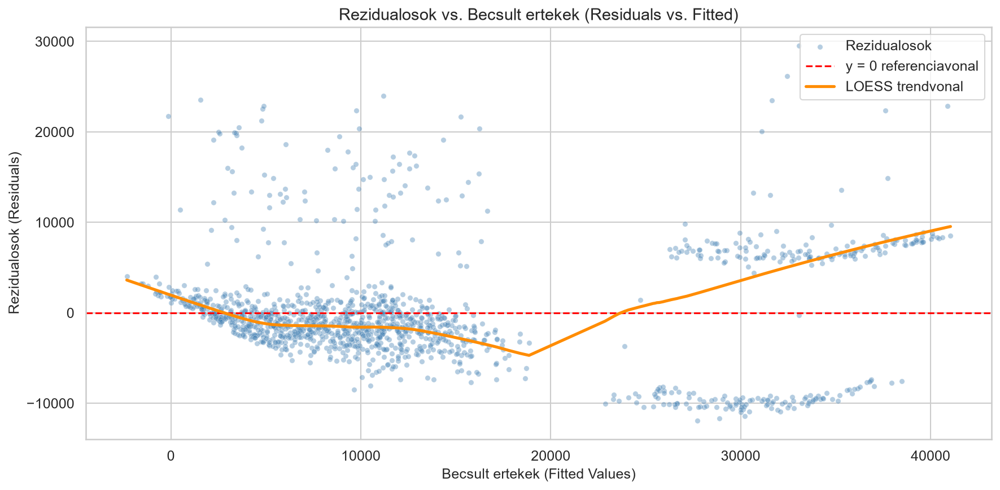
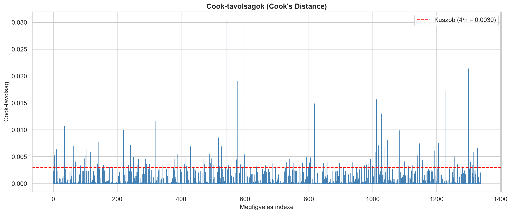

# Egeszsegbiztositasi Koltsegek - OLS Elemzes Osszefoglalo

Az elemzes sikeresen lefutott. Az alabbiakban a teljes munkafolyamat osszefoglalasa.

## Fajlok

| Fajl | Leiras |
|------|--------|
| [`medical_cost_analysis.py`](file:///c:/Users/hp/Antigravity/Linear%20Regression/medical_cost_analysis.py) | Teljes elemzesi szkript (8 szekcio) |
| [`plots/`](file:///c:/Users/hp/Antigravity/Linear%20Regression/plots) | 11 generalt abra (PNG) |

## Munkafolyamat (8 lepes)

### 1. Adatbazis beolvasas
- **1338 megfigyeles**, 7 valtozo
- **1 duplikatum** talaltuk es eltavoliotottuk -> 1337 sor
- Nincs hianyzo ertek

### 2. Feltaro adatelemzes (EDA)
- 4 numerikus valtozo: `age`, `bmi`, `children`, `charges`
- 3 kategorikus valtozo: `sex`, `smoker`, `region`

````carousel

<!-- slide -->

<!-- slide -->

<!-- slide -->

<!-- slide -->

````

### 3. Spearman korrelacio + One-Hot Encoding
- `drop_first=True, dtype=float` -> 9 oszlop a kodolas utan
- Legerosebb korrelacio a celvaltozoval: **`smoker_yes` (rho=0.66)**, `age` (rho=0.53)



### 4. Korrelacio-szures es VIF
- **Nincs** valtozo-par `|r| > 0.7` -> nincs korrelacio-alapu szures
- **Minden VIF < 5** (max: `region_southeast` = 1.65) -> nincs multikollinearitas

### 5. Alap OLS modell (8 valtozo)
| Mutato | Ertek |
|--------|-------|
| R-squared | 0.7507 |
| Adj. R-squared | 0.7492 |
| RMSE | 6043.85 |

### 6. Backward Elimination (alpha = 0.05)

| Lepes | Kiszurt valtozo | p-ertek | Adj. R-sq |
|-------|-----------------|---------|-----------|
| #1 | `sex_male` | 0.6976 | 0.7494 |
| #2 | `region_northwest` | 0.4652 | 0.7495 |
| #3 | `region_southwest` | 0.0582 | 0.7490 |
| #4 | `region_southeast` | 0.1356 | 0.7488 |

> [!IMPORTANT]
> **Vegso valtozok**: `age`, `bmi`, `children`, `smoker_yes`

### 7. Modell-osszehasonlitas

| Mutato | Alapmodell (8 var.) | Vegso modell (4 var.) |
|--------|--------------------|-----------------------|
| R-sq | 0.7507 | 0.7495 |
| Adj. R-sq | 0.7492 | 0.7488 |
| F-stat | 500.0 | **996.5** |
| AIC | 27094.2 | **27092.8** |
| RMSE | 6043.9 | 6058.6 |

> [!TIP]
> A vegso modell 4 valtozoval szinte azonos magyarazoerovel bir, de egyszerubb es jobb F-statisztikaval rendelkezik.

### 8. Diagnosztikai vizsgalatok

| Teszt | Eredmeny | Kovetkeztetes |
|-------|----------|---------------|
| **Shapiro-Wilk** | p = 0.000 | Nem normalis rezidualosok |
| **Jarque-Bera** | p = 0.000 | Nem normalis rezidualosok |
| **Breusch-Pagan** | p = 0.000 | Heteroszkedaszticitas jelen van |
| **Durbin-Watson** | DW = 2.088 | Nincs autokorrelacio |
| **Cook's Distance** | 112 pont (8.4%) > 4/n | Befolyasos pontok vannak |

````carousel

<!-- slide -->

<!-- slide -->

````

> [!WARNING]
> Heteroszkedaszticitas miatt a **HC3 robusztus standard hibas** modell is elkeszult (8.5 szekcio).
> A robusztus SE-k nemileg magasabbak, de minden valtozo szignifikans marad.

## Zaro eredmeny

```
Vegso modell: charges ~ const + age + bmi + children + smoker_yes
R-sq     = 0.7495  (74.95%)
Adj R-sq = 0.7488  (74.88%)
RMSE     = 6058.64
MAE      = 4181.34
```
